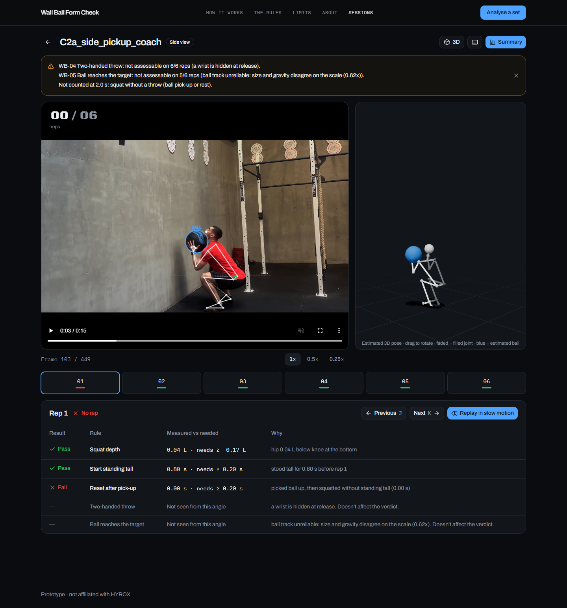
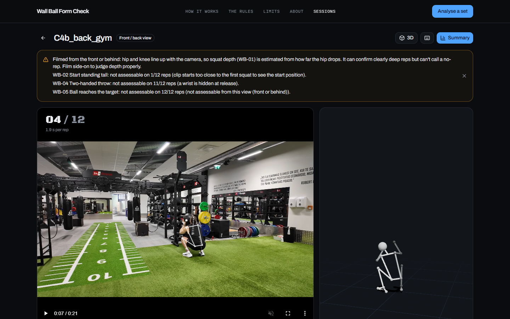
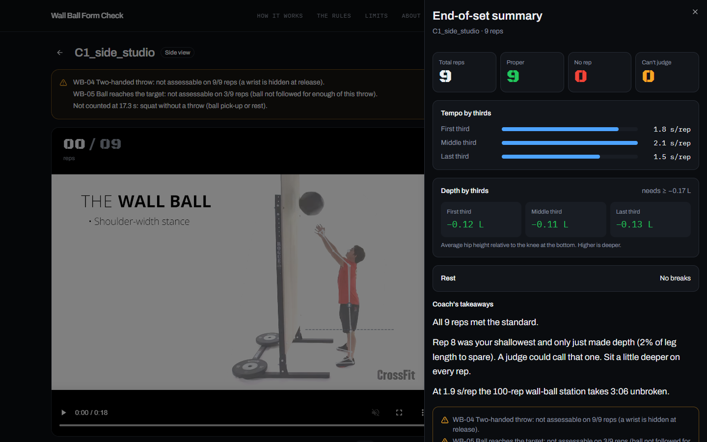

# HYROX Wall Ball form check

A rule-based prototype that watches a wall-ball set and judges every rep against the HYROX rulebook. It reads a video,
tracks the body with MediaPipe Pose, splits the set into reps, applies five rules from one config file, and plays the
video back with a skeleton overlay, a live rep counter, per-rep verdicts, a set summary and a 3D view.

No trained models of our own: every decision is a threshold you can read, with its rulebook source, in
[`backend/analysis/rules.yaml`](backend/analysis/rules.yaml). When the camera can't support a decision the app says
**"can't judge"** and never guesses.


*Playback with the skeleton overlay, live counter, verdict and 3D view. Rep 1 is a no-rep: the coach picked the
ball up and went straight into the squat without standing tall (WB-03).*

| Doc | What's in it |
|---|---|
| This README | How to run it, how it works, results, failures, limits |
| [`docs/part2_imu_emg.md`](docs/part2_imu_emg.md) | **Part 2:** which camera gaps IMU and EMG close, and how to fuse them |
| [`PRD.md`](PRD.md) | The plan of record: requirements, data contracts, design decisions |
| [`RESEARCH.md`](RESEARCH.md) | Papers reviewed, ranked improvement plan, Kalman ball-tracker results |
| [`clips/clips.md`](clips/clips.md) | Where each test clip comes from and what it tests |

---

## Windows setup

Use these steps on 64-bit Windows with PowerShell. The first setup needs an internet connection to download Python packages, the pose model and the browser app's dependencies. The app runs locally after setup. You can use a video elsewhere on your computer.

### 1. Open the project folder

In File Explorer, open the folder containing this README, `setup.ps1`, `backend` and `frontend`. Click the address bar, type `powershell` and press Enter. Run the commands below in that window. For the existing checkout on this computer you can also open PowerShell and run `Set-Location 'D:\projects\Hyrox'`.

On a new computer, download the project ZIP **from the revision containing this setup guide**, extract it first, then open the extracted folder as above. Git users can clone the [repository](https://github.com/UdaiBatta/hyrox) and check out that revision.

### 2. Install the tools once

- **uv** manages Python 3.11 and installs the backend packages. In PowerShell run `winget install --id astral-sh.uv --exact`. [Official uv installation guide](https://docs.astral.sh/uv/getting-started/installation/)
- **FFmpeg** reads video files. Run `winget install --id Gyan.FFmpeg --exact`. This installs both `ffmpeg` and `ffprobe`. If WinGet is unavailable, extract the Windows essentials build and add its `bin` directory to your user Path. [Windows FFmpeg builds](https://www.gyan.dev/ffmpeg/builds/)
- **Node.js 24.x** runs the browser app and includes npm. Open the [official Node 24 downloads](https://nodejs.org/dist/latest-v24.x/), choose the Windows installer ending in `-x64.msi`, and keep the default npm and PATH options.
- **curl.exe** downloads the pose model. Recent Windows versions include it. If `curl.exe --version` is unavailable, install the [Windows curl build](https://curl.se/windows/) and add its `bin` directory to your user Path.

Close PowerShell, then reopen it from the project folder so it picks up the new tools. Each command below should print a version. If a command is missing, finish the matching install above before continuing.

```powershell
uv --version
ffmpeg -version
ffprobe -version
node --version
npm.cmd --version
curl.exe --version
```

### 3. Set up the app

From the folder containing `setup.ps1`, run:

```powershell
powershell.exe -NoProfile -ExecutionPolicy Bypass -File .\setup.ps1
```

The execution-policy option applies to this invocation only. Wait for **Setup complete**. The script installs the Python packages from `backend/uv.lock` in `backend/.venv`, obtaining Python 3.11 if needed. It downloads the versioned MediaPipe model into `backend/models` and verifies its SHA-256 checksum. It creates `backend/media/videos`, applies the SQLite migrations to `backend/db.sqlite3`, and installs the browser dependencies from `frontend/package-lock.json` with `npm ci`. You can rerun setup after an interrupted download or after updating the checkout.

### Run a video from PowerShell

Start in the project folder. This example uses the CrossFit file on Udai's computer. In another checkout, change the quoted path to a real local video. The raw CrossFit file is distributed separately. The example stops with a message if the file is missing.

```powershell
$video = 'D:\projects\Hyrox\clips\raw\crossfit_full.mp4'
if (!(Test-Path -LiteralPath $video -PathType Leaf)) { throw "Video missing: $video. Set the path to your own video." }
Set-Location backend
uv run --no-sync python -m analysis.pipeline "$video" --out "media/videos/crossfit_full_run"
```

Wait for a printed list of reps and verdicts. Open `backend/media/videos/crossfit_full_run/analysis.json` for the results. That folder also holds the normalized video and cached tracks. **Use a different output folder for each different video** because the CLI reuses tracks already in that folder. For a fresh analysis of the same source, choose a new folder name. CLI runs write files directly. Upload through the web app if you want a session in the browser's session list.

### Open the web app

Open **two PowerShell windows from the project folder** as in step 1. Leave both running.

**Window 1** starts the backend:

```powershell
Set-Location backend
uv run --no-sync python manage.py runserver 127.0.0.1:8000
```

**Window 2** starts the browser app:

```powershell
Set-Location frontend
npm.cmd run dev -- --host 127.0.0.1 --port 5173 --strictPort
```

Open [the app](http://127.0.0.1:5173), upload your MP4, MOV or M4V (up to 500 MB), wait for processing, then open the session to play it. If a port is busy, stop the previous copy of that server with Ctrl+C and retry. To shut down the app, press Ctrl+C in both windows.

### Verify the installation

For a quick visual check on a fresh checkout, open [the bundled synthetic session](http://127.0.0.1:5173/sessions/mock?mock=1) while the frontend is running. Its playback data ships with the project. Use the upload flow above to exercise tracking on real footage.

Open another PowerShell window **from the project folder**. The backend test processes a generated video through the API. The evaluation commands use the repository's cached tracks and labels. You can run them before uploading a video.

```powershell
uv run --project backend --no-sync python backend/manage.py test analysis.tests
npm.cmd --prefix frontend test
node eval/evaluate.ts
uv run --project backend --no-sync python eval/depth_evaluate.py
```

---

## How it works

```
video ─► normalise (ffmpeg: rotation, constant fps)
      ─► MediaPipe Pose Landmarker heavy, every frame (33 points + visibility)        cached
      ─► clean: bridge gaps ≤ 0.2 s, Savitzky–Golay smoothing (~0.15 s)
      ─► view: side-on vs front/back, from shoulder width ÷ torso length
      ─► reps: squat bottoms = hip-height peaks; a rep needs a throw after it (wrists above the nose)
      ─► ball: Hough circle at the hands, then a gravity Kalman filter + RTS smoother in flight   cached
      ─► rules WB-01…05 per rep ─► verdict ─► summary + warnings ─► analysis.json
```

**Units that don't depend on the camera.** Distances are in **L**, the athlete's own leg length in pixels
(hip→knee + knee→ankle), measured per rep. "Hip 0.10 L above the knee" means the same thing near or far from the
camera and for tall or short athletes.

**Rep segmentation.** The signal is the hip height (left/right averaged, since side-on MediaPipe swaps the near and
far leg). A squat bottom is a peak that drops at least 0.15 L and is at least 0.8 s from the next one. A bottom only
counts as a rep if a throw follows, so a ball pick-up or a resting dip is listed as "not counted", with the reason.

**Verdict.** Each rule returns pass / fail / not assessable, plus a low-confidence flag near its threshold.
- **No-rep:** any rule fails confidently.
- **Can't judge:** a *required* rule can't be assessed, or is borderline.
- **Good rep:** otherwise.

Optional rules (two hands, target) can fail a rep when they're sure, but a hidden wrist or an untracked ball doesn't
make every rep "can't judge".

Every rep has a breakdown: each rule's result, the measured value against the threshold, and the reason. Rules the
camera can't see say so and don't affect the verdict.



### The rules ([`rules.yaml`](backend/analysis/rules.yaml), HYROX Singles Rulebook 2025/26, §9.8 pp. 26–27)

| Rule | Standard | How it's measured | Threshold and why |
|---|---|---|---|
| **WB-01** Squat depth (required) | "hips must descend lower than their knees" | Side-on compares a visible hip and knee on the same side at the bottom, normalized by observed leg length. Front/back uses hip height above the ankle relative to standing height on the same side. | **−0.08 L** for side-on. The nine legal C1 calibration reps measure −0.071 to −0.050 L. A miss of less than 0.03 L is borderline. From behind, the hip-drop ratio must be ≤ 0.27 to confirm depth. |
| **WB-02** Start standing tall (required) | "start by standing tall (hips and knees extended)" | Hip and knee angles before rep 1 | ≥ 160° for ≥ 0.2 s. Full extension is 175–180°, pose jitter ±5–10° |
| **WB-03** Reset after pick-up (required) | No pick-up and immediate throw | Both wrists below the knees = pick-up; then the same stand-tall check before the next squat | As WB-02 |
| **WB-04** Two-handed throw (optional) | "throws the ball (with both hands)" | Both wrists above the nose and ≤ 0.6 L apart at release | The ball is ~0.4 L across. Optional because side-on the far wrist is hidden on practically every rep |
| **WB-05** Ball reaches target (optional) | 3.00 m men / 2.70 m women | Ball peak height in metres. The ball's diameter is the ruler; the curvature of its flight (gravity) checks the ruler | Within 0.15 m = borderline. Rulers must agree within 25%. Side-on only |

**Ball tracking (WB-05).** The ball is found at the hands while held, then followed in flight by a Kalman filter
with gravity built in. A solid ring means the ball was seen; a dashed ring means the filter estimated its position.
The 3D view shows the same ball.


### Design choices and trade-offs
- **Rules, not a classifier.** Every verdict can be explained and tuned by a coach in one file, and it needs no
  labelled training data. Cost: thresholds come from a small calibration set (see *Limits*).
- **"Can't judge" is a real answer.** A wrong no-rep costs an athlete time and trust, so uncertainty is shown, not
  hidden.
- **MediaPipe over OpenPose:** it runs on a CPU, gives a visibility score per point (which drives "can't judge"), and
  has a usable 3D world model. The trade-off is weaker far-side accuracy side-on (RESEARCH.md §0 has the A/B plan).
- **3D view is display only.** The skeleton is lifted from the 2D points with bone lengths and movement priors.
  Joints the camera can't see are estimated and drawn faded (3D) or dashed (2D). Rules never use estimated joints.

---

## Results on the test clips

Web clips (sources in [`clips/clips.md`](clips/clips.md)): four side-on, three from behind. Hand counts and labels
were made by stepping through every clip in 0.3 s stills and checking each bottom-of-squat frame at full size
([`eval/labels.csv`](eval/labels.csv), with a note on every judgement call).

| Clip | View | Reps found | Hand count | Good | No-rep | Can't judge | What it shows |
|---|---|---|---|---|---|---|---|
| C1 studio | Side | 9 | 9 | 9 | 0 | 0 | Official standard demo; calibration reference for WB-01. Pick-up at 17.3 s correctly not counted |
| C1b gym | Side | 4 | **5** | 4 | 0 | 0 | **Miss:** the clip opens at the bottom of a squat. A peak at frame 0 can't be found, so that rep isn't counted (its throw is listed as "not counted"). Ball peaks 2.95–3.15 m against a 3 m target, all borderline, so not a no-rep |
| C2a coach | Side | 6 | 6 | 5 | **1** | 0 | **WB-03 caught:** the coach picks the ball up and goes straight into the squat (0.00 s standing). Confirmed in the stills |
| C2b coach | Side | 8 | 8 | 7 | **1** | 0 | **WB-03 caught** again on the rep after the pick-up. Confirmed in the stills |
| C4a studio | Behind | 5 | 5 | 4 | 0 | 1 | Depth confirmed on all five. The opening standing hold extends outside the clip. |
| C4b gym | Behind | 12 | 12 | 11 | 0 | 1 | Rep 1: the clip starts mid-set, so "started standing tall" can't be judged. Reps 8–9 are 1.3 s apart; the stills confirm two real, fast reps |
| C4c Mixkit | Behind | 4 | 4 | 3 | 0 | 1 | Both ankles are cropped at the first squat bottom (2.29 s). Depth is unassessable. |

### Evaluation against the hand labels

`node eval/evaluate.ts` (from the repo root):

```
reps: 49 labelled, 1 missed by the app, 0 extra

                 app: good  no-rep  can't judge
label good            43       0            3
label no-rep           0       2            0

verdict agreement: 45/45 decided reps (100%); the app decided 45/48 matched reps
no-reps caught with the right rule: 2/2
```

The two no-reps in these seven clips are pickup faults. The author labelled this set from stills. Squat-depth
performance is measured separately below.

### Filmed squat-depth test

Run `python eval/depth_evaluate.py` from the repo root with the backend environment. It reruns WB-01 on cached
pose tracks, matches each labelled bottom within half a second and reports every missed or extra rep. The four
excerpts and label sources are listed in [the clip inventory](clips/clips.md#filmed-squat-depth-benchmark).

| Video label | Passed depth | Failed depth | Can't judge | Missed |
|---|---:|---:|---:|---:|
| Deep | 4 | 0 | 0 | 0 |
| Borderline | 0 | 1 | 1 | 0 |
| Shallow | 0 | 1 | 4 | 0 |

All 11 throws were detected, with zero extras. The judge caught the full-body Open 13.3 no-rep. It abstained
on all four shallow throws in the Open 12.4 close-up with weak knee observations. It issued a confident no-rep
on one of two visually borderline throws (C2d, 3.87 s). These clips cover three athletes. The threshold was set
on C1. The Open 12.4 close-up also informed the hidden-bottom fix, so this is a regression benchmark.

### Shallow-rep test (WB-01 on real tracking)

[`eval/shallow_sweep.py`](eval/shallow_sweep.py) varies depth under controlled conditions. It takes every original
side-on rep and raises the hips and upper body so the rep reaches only *k* of its real depth (knees and feet
unchanged), then runs the unchanged pipeline.

| Clip | First confident depth failure at *k* = | Still found at *k* = 0.4? |
|---|---|---|
| C1 studio | 0.9 (all nine) | 9/9 |
| C1b gym | 0.7 (all by 0.6) | 4/4 |
| C2a coach | 0.7 (all six) | 6/6 |
| C2b coach | 0.7 (all eight) | 8/8 |

All 27 original side-on reps remain detectable at 40% of the original hip drop. At 80% the nine studio reps
fail and the six C2a coach reps pass. The sweep measures sensitivity to modifying coordinates for a given athlete.

**Rule coverage** (how often each rule could be judged, from the app's warnings):
- **WB-01 depth:** 27/27 original side-on reps and 20/21 rear-view reps. The first Mixkit rep has no ankle reference.
- **WB-04 two hands:** 0 of 27 side-on reps (far wrist hidden). From behind: 10 of 21.
- **WB-05 target:** 11 of 27 side-on reps. On the two coach clips the two rulers disagree by a constant 0.62–0.68×,
  which points to an edited or slowed clip, so the app refuses to guess.

---

## Failures and honest limits

1. **Shallow-rep coverage is low.** WB-01 made a confident depth call on one of the five filmed shallow reps.
2. **Borderline calls need further validation.** One of two visually borderline reps was confidently failed.
   Independent labels on another full-body set would help determine how often this happens.
3. **One labeller (the author), from stills.** No second labeller, so there's no human-vs-human ceiling. 49 reps
   across 7 web clips is a small set.
4. **A rep whose bottom is the clip's first frame isn't counted** (C1b). Harmless on a real recording that starts
   standing; it shows up on trimmed web clips.
5. **From behind, depth can only pass.** Perspective makes reps look deeper from behind (0.23–0.25 vs 0.33–0.38
   side-on for the same reps), so a no-rep from that view would not be trustworthy. Part 2 fixes this with a thigh
   IMU.
6. **Two-handed throw is almost never judgeable side-on.** One camera can't see the far wrist. Part 2 fixes this with
   wrist IMUs.
7. **Pose errors MediaPipe is confident about pass through.** For example, C4b frame 5 reports the hidden right knee
   as visible but in the wrong place. Smoothing hides small errors, not confident wrong ones.
8. **One athlete in frame is assumed.** Race footage with several athletes is out of scope.
9. **3D view:** joints hidden at the bottom of the squat (arms behind the back, far knee) are estimated, not seen.
   They're shown faded so nobody mistakes them for measurements.


*From behind, the warning says what can't be judged from this view. Depth is only confirmed, never failed. Joints
hidden at the bottom of the squat are estimated (dashed in 2D, faded in 3D).*


---

## Session summary



At the end of the set the summary shows:
- totals (good / no-rep / can't judge);
- the most common fault, with the rule's coaching tip;
- seconds per rep for each third of the set;
- depth for each third of the set;
- breaks and total rest;
- 1–2 takeaways from fixed templates (no LLM).

Up to 3 takeaways, most important first:

| Takeaway | Fires when |
|---|---|
| Most common fault, with the rule's coaching tip | Any confident no-rep |
| "Depth faded as you tired" (with the cost of a redo) | Shallow no-reps rise from the first third to the last |
| **"Your squats got shallower across the set"** | Depth worsens by ≥ 5% of leg length before any rep fails: an early fatigue warning |
| **"Rep N only just made depth"** | The shallowest passing rep is within 6% of leg length of the standard |
| **"Your depth varied by X%"** | Deepest vs shallowest passing rep differ by ≥ 8% of leg length |
| Pace slowed from X to Y s/rep | Last third ≥ 15% slower than the first |
| **Breaks, measured against the athlete's own rhythm** | A gap > 3 s *and* > 1.5× their median rep time; rest = time lost against that rhythm |
| **Projected station time** | Always: "At 1.9 s/rep the 100-rep station takes 3:07 unbroken" (plus "with breaks" if any) |

Bold rows are new. Breaks used to count every gap over 3 s, so C4c's steady 3.3 s/rep set was reported as
"3 breaks, 10 s rest"; that was wrong and is fixed.

There is deliberately no "you had plenty of depth to spare" message. The margin is measured against a threshold whose
offset varies by athlete (shallow-rep test above), so the app never tells anyone they can squat shallower.

On the short web clips the app reports faults, close calls, coverage and projected pace. The fatigue messages need a full set and are covered by
`backend/analysis/tests/test_pipeline.py` (`SummaryTest`).

---

## Other screens

| Landing | Sessions |
|---|---|
|  |  |

---

## Next steps
1. Film and label own side-on clips, including deliberate shallow reps, with a second labeller; add them to
   `eval/depth_labels.csv` and run `depth_evaluate.py`. Reserve a separate athlete or recording for the final
   accuracy check before changing the threshold again.
2. A/B MediaPipe vs RTMPose on the labelled reps (far-side accuracy).
3. SAM 2 for ball segmentation; GVHMR for a world-grounded 3D body (RESEARCH.md §2).
4. Evaluate whether a strictness setting helps after collecting independent labels.
5. Part 2 sensors: thigh and wrist IMUs first ([`docs/part2_imu_emg.md`](docs/part2_imu_emg.md)).

## Repo layout
```
backend/   Django + DRF API, background job, analysis/pipeline/ (pose, signals, ball, rules, summary), rules.yaml, tests
frontend/  React 19 + TypeScript (strict) + Vite + Tailwind + shadcn/ui + three.js (react-three-fiber)
clips/     test clips and their sources
eval/      hand labels, evaluate.ts (agreement), shallow_sweep.py (WB-01 shallow-rep test)
docs/      Part 2 note
```
