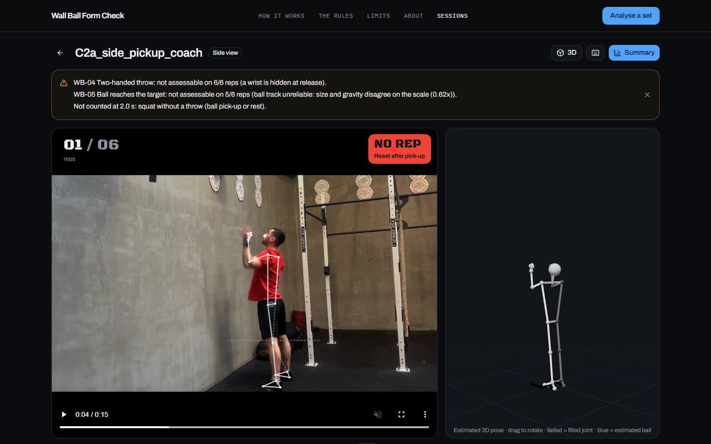
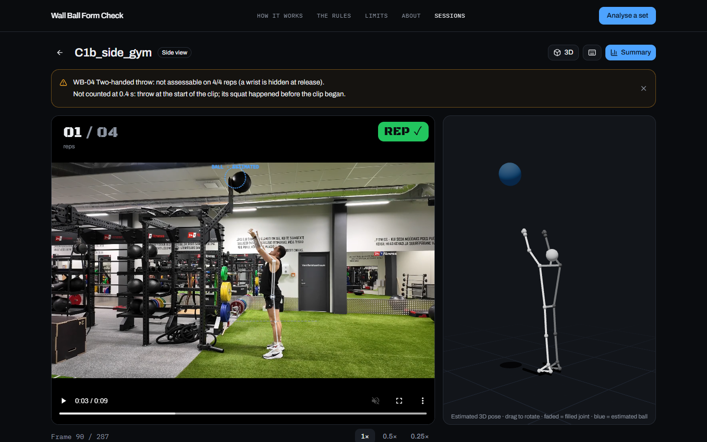
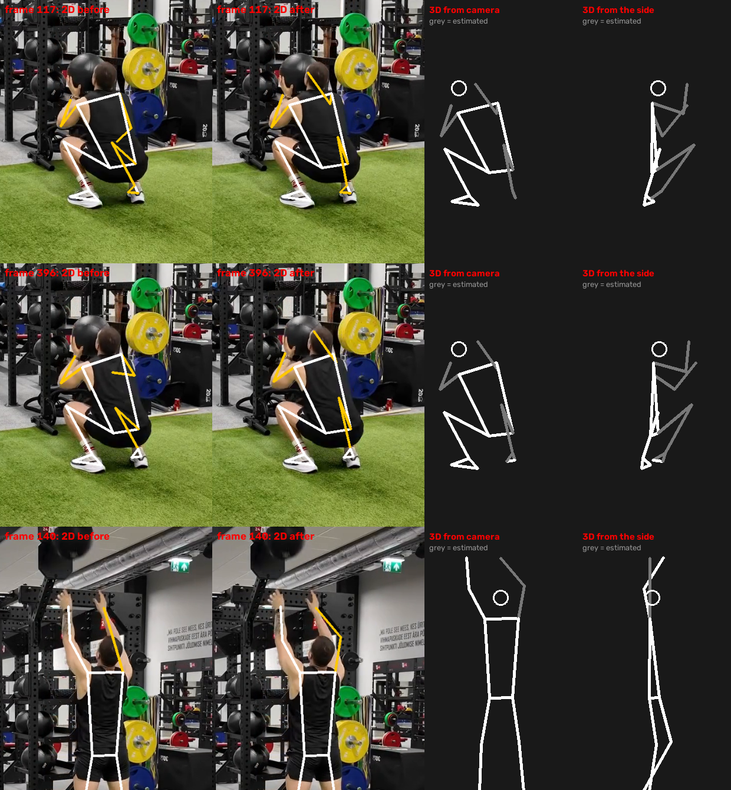
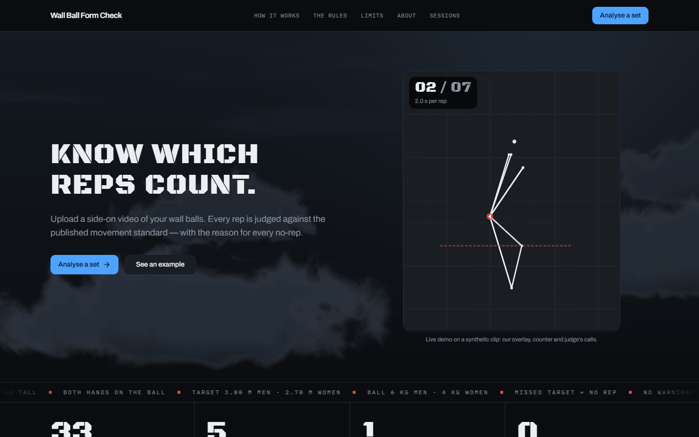
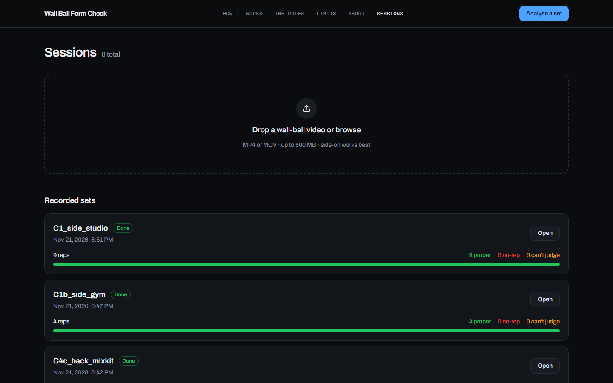

# HYROX Wall Ball form check

A rule-based prototype that watches a wall-ball set and judges every rep against the HYROX rulebook. It reads a video,
tracks the body with MediaPipe Pose, splits the set into reps, applies five rules from one config file, and plays the
video back with a skeleton overlay, a live rep counter, per-rep verdicts, a set summary and a 3D view.

No trained models of our own: every decision is a threshold you can read, with its rulebook source, in
[`backend/analysis/rules.yaml`](backend/analysis/rules.yaml). When the camera can't support a decision the app says
**"can't judge"** and never guesses.


*Playback with the skeleton overlay, live counter, verdict and 3D view. Rep 1 is a no-rep: the coach picked the
ball up and went straight into the squat without standing tall (WB-03).*

| Doc | What's in it |
|---|---|
| This README | How to run it, how it works, results, failures, limits |
| [`docs/part2_imu_emg.md`](docs/part2_imu_emg.md) | **Part 2:** which camera gaps IMU and EMG close, and how to fuse them |
| [`PRD.md`](PRD.md) | The plan of record: requirements, data contracts, design decisions |
| [`RESEARCH.md`](RESEARCH.md) | Papers reviewed, ranked improvement plan, Kalman ball-tracker results |
| [`clips/clips.md`](clips/clips.md) | Where each test clip comes from and what it tests |

---

## Run it

Needs Python 3.11, Node 24 and `ffmpeg` on the PATH. The MediaPipe model
([pose_landmarker_heavy.task](https://storage.googleapis.com/mediapipe-models/pose_landmarker/pose_landmarker_heavy/float16/latest/pose_landmarker_heavy.task))
goes in `backend/models/`.

```powershell
cd backend
py -3.11 -m venv .venv
.venv\Scripts\pip install -r requirements.txt
.venv\Scripts\python manage.py migrate
.venv\Scripts\python manage.py runserver 127.0.0.1:8000
```

```powershell
cd frontend
npm install
npm run dev
```

Open http://localhost:5173, upload a clip (any from `clips/`), wait about a minute per minute of video, then play
it back. Shortcuts: `Space` play, `←/→` frame step, `3` toggle 3D, `s` summary, `?` all shortcuts.

**Without the UI:** `python -m analysis.pipeline ../clips/C1b_side_gym.mp4` (from `backend/`) prints every rep,
every rule result, the summary and the warnings.

**Tests:** `python manage.py test` (backend: a synthetic set with one shallow rep, summary takeaways, the ball
tracker, the API) and `npm test` (frontend: playback state, 3D reconstruction).

**Evaluation:** `node eval/evaluate.ts` (repo root) scores the app against the hand labels in `eval/labels.csv`;
`python ../eval/shallow_sweep.py` (from `backend/`) runs the shallow-rep test. Both read the analysed clips listed
in `eval/clips.json`, so upload the clips first.

---

## How it works

```
video ─► normalise (ffmpeg: rotation, constant fps)
      ─► MediaPipe Pose Landmarker heavy, every frame (33 points + visibility)        cached
      ─► clean: bridge gaps ≤ 0.2 s, Savitzky–Golay smoothing (~0.15 s)
      ─► view: side-on vs front/back, from shoulder width ÷ torso length
      ─► reps: squat bottoms = hip-height peaks; a rep needs a throw after it (wrists above the nose)
      ─► ball: Hough circle at the hands, then a gravity Kalman filter + RTS smoother in flight   cached
      ─► rules WB-01…05 per rep ─► verdict ─► summary + warnings ─► analysis.json
```

**Units that don't depend on the camera.** Distances are in **L**, the athlete's own leg length in pixels
(hip→knee + knee→ankle), measured per rep. "Hip 0.10 L above the knee" means the same thing near or far from the
camera and for tall or short athletes.

**Rep segmentation.** The signal is the hip height (left/right averaged, since side-on MediaPipe swaps the near and
far leg). A squat bottom is a peak that drops at least 0.15 L and is at least 0.8 s from the next one. A bottom only
counts as a rep if a throw follows, so a ball pick-up or a resting dip is listed as "not counted", with the reason.

**Verdict.** Each rule returns pass / fail / not assessable, plus a low-confidence flag near its threshold.
- **No-rep:** any rule fails confidently.
- **Can't judge:** a *required* rule can't be assessed, or is borderline.
- **Good rep:** otherwise.

Optional rules (two hands, target) can fail a rep when they're sure, but a hidden wrist or an untracked ball doesn't
make every rep "can't judge".

Every rep has a breakdown: each rule's result, the measured value against the threshold, and the reason. Rules the
camera can't see say so and don't affect the verdict.


### The rules ([`rules.yaml`](backend/analysis/rules.yaml), HYROX Singles Rulebook 2025/26, §9.8 pp. 26–27)

| Rule | Standard | How it's measured | Threshold and why |
|---|---|---|---|
| **WB-01** Squat depth (required) | "hips must descend lower than their knees" | Side-on: hip joint centre vs knee joint centre at the bottom, in L. Front/back: hip height at the bottom ÷ standing hip height | **−0.17 L.** MediaPipe's hip point sits above the hip crease and its knee point below the top of the knee, so joint centre vs joint centre is stricter than a judge. Calibrated on CrossFit's official standard video (legal by definition): −0.10 to −0.15 L. A first guess of −0.03 failed all 9 legal reps. Front/back can only *confirm* clearly deep reps (≤ 0.27), never call a no-rep |
| **WB-02** Start standing tall (required) | "start by standing tall (hips and knees extended)" | Hip and knee angles before rep 1 | ≥ 160° for ≥ 0.2 s. Full extension is 175–180°, pose jitter ±5–10° |
| **WB-03** Reset after pick-up (required) | No pick-up and immediate throw | Both wrists below the knees = pick-up; then the same stand-tall check before the next squat | As WB-02 |
| **WB-04** Two-handed throw (optional) | "throws the ball (with both hands)" | Both wrists above the nose and ≤ 0.6 L apart at release | The ball is ~0.4 L across. Optional because side-on the far wrist is hidden on practically every rep |
| **WB-05** Ball reaches target (optional) | 3.00 m men / 2.70 m women | Ball peak height in metres. The ball's diameter is the ruler; the curvature of its flight (gravity) checks the ruler | Within 0.15 m = borderline. Rulers must agree within 25%. Side-on only |

**Ball tracking (WB-05).** The ball is found at the hands while held, then followed in flight by a Kalman filter
with gravity built in. A solid ring means the ball was seen; a dashed ring means the filter estimated its position.
The 3D view shows the same ball.



### Design choices and trade-offs
- **Rules, not a classifier.** Every verdict can be explained and tuned by a coach in one file, and it needs no
  labelled training data. Cost: thresholds come from a small calibration set (see *Limits*).
- **"Can't judge" is a real answer.** A wrong no-rep costs an athlete time and trust, so uncertainty is shown, not
  hidden.
- **MediaPipe over OpenPose:** it runs on a CPU, gives a visibility score per point (which drives "can't judge"), and
  has a usable 3D world model. The trade-off is weaker far-side accuracy side-on (RESEARCH.md §0 has the A/B plan).
- **3D view is display only.** The skeleton is lifted from the 2D points with bone lengths and movement priors.
  Joints the camera can't see are estimated and drawn faded (3D) or dashed (2D). Rules never use estimated joints.

---

## Results on the test clips

Web clips (sources in [`clips/clips.md`](clips/clips.md)): four side-on, three from behind. Hand counts and labels
were made by stepping through every clip in 0.3 s stills and checking each bottom-of-squat frame at full size
([`eval/labels.csv`](eval/labels.csv), with a note on every judgement call).

| Clip | View | Reps found | Hand count | Good | No-rep | Can't judge | What it shows |
|---|---|---|---|---|---|---|---|
| C1 studio | Side | 9 | 9 | 9 | 0 | 0 | Official standard demo; calibration reference for WB-01. Pick-up at 17.3 s correctly not counted |
| C1b gym | Side | 4 | **5** | 4 | 0 | 0 | **Miss:** the clip opens at the bottom of a squat. A peak at frame 0 can't be found, so that rep isn't counted (its throw is listed as "not counted"). Ball peaks 2.95–3.15 m against a 3 m target, all borderline, so not a no-rep |
| C2a coach | Side | 6 | 6 | 5 | **1** | 0 | **WB-03 caught:** the coach picks the ball up and goes straight into the squat (0.00 s standing). Confirmed in the stills |
| C2b coach | Side | 8 | 8 | 7 | **1** | 0 | **WB-03 caught** again on the rep after the pick-up. Confirmed in the stills |
| C4a studio | Behind | 5 | 5 | 5 | 0 | 0 | Same athlete as C1 from behind. Depth confirmed from hip drop (0.23–0.25) |
| C4b gym | Behind | 12 | 12 | 11 | 0 | 1 | Rep 1: the clip starts mid-set, so "started standing tall" can't be judged. Reps 8–9 are 1.3 s apart; the stills confirm two real, fast reps |
| C4c Mixkit | Behind | 4 | 4 | 4 | 0 | 0 | Slow, steady set (3.3 s/rep) |

### Evaluation against the hand labels

`node eval/evaluate.ts` (from the repo root):

```
reps: 49 labelled, 1 missed by the app, 0 extra

                 app: good  no-rep  can't judge
label good            45       0            1
label no-rep           0       2            0

verdict agreement: 47/47 decided reps (100%); the app decided 47/48 matched reps
no-reps caught with the right rule: 2/2
```

**Read this with care.** The labels contain only 2 no-reps, both WB-03, and **no shallow squats**: none of the web
footage has any. 100% agreement here shows that counting works and that the app doesn't invent no-reps. It does
**not** show that WB-01 catches shallow squats. The labeller is the author, from stills, not a HYROX judge.

### Shallow-rep test (WB-01 on real tracking)

With no real shallow squats available, [`eval/shallow_sweep.py`](eval/shallow_sweep.py) makes them. It takes every real
side-on rep and raises the hips and upper body so the rep reaches only *k* of its real depth (knees and feet
unchanged), then runs the unchanged pipeline.

| Clip | Thigh at the bottom, real reps (joint centres, + = hip below knee) | Rep first flagged at *k* = | Still found at *k* = 0.4? |
|---|---|---|---|
| C1 studio | −25° to −19° | 0.9 (all no-reps by 0.8) | 9/9 |
| C1b gym | +11° to +18° | 0.6 (all by 0.5) | 4/4 |
| C2a coach | +1° to +7° | 0.6 (all by 0.5) | 6/6 |
| C2b coach | −1° to +5° | 0.6 (all by 0.6) | 8/8 |

**What this shows:**
1. **Shallow reps are never silently dropped.** Even a quarter squat (40% of real depth) is still segmented as a
   rep, then called a no-rep.
2. **WB-01 does fire on real, noisy keypoints**, not only on the synthetic test.
3. **The weakness, measured:** the C1 athlete and the C2 coach both squat to about parallel in the stills, but
   MediaPipe's joint centres put C1's thigh about 20° *above* horizontal and the coach's at about horizontal. The
   threshold had to accept C1's legal reps, so a coach rep raised to 70% of its depth (a thigh about 15–20° above
   parallel) still passes. **One fixed threshold can't be both safe for C1 and strict for C2.** The cause is where
   MediaPipe places the hip point, which varies by athlete, clothing and camera height. Fixes, in order:
   - a better hip landmark (RTMPose/ViTPose A/B, RESEARCH.md);
   - a per-athlete check against a filmed known-parallel rep;
   - a thigh IMU, which measures the angle directly (Part 2).

**Rule coverage** (how often each rule could be judged, from the app's warnings):
- **WB-01 depth:** every rep. Side-on it's measured; from behind it's confirmed only.
- **WB-04 two hands:** 0 of 27 side-on reps (far wrist hidden). From behind: 10 of 21.
- **WB-05 target:** 11 of 27 side-on reps. On the two coach clips the two rulers disagree by a constant 0.62–0.68×,
  which points to an edited or slowed clip, so the app refuses to guess.

---

## Failures and honest limits

1. **No real shallow squat has been filmed.** WB-01's no-rep behaviour is shown only on shallowed copies of real
   reps (above) and in the synthetic test. Filmed, labelled shallow reps are the next step, and the most important
   one.
2. **WB-01 is too lenient for some athletes** (measured above): with a single threshold, a rep about 15–20° above
   parallel can pass for an athlete whose hip point MediaPipe places low. The calibration used only legal reps from
   one athlete, so the threshold sits at the loosest value that passes them all.
3. **One labeller (the author), from stills.** No second labeller, so there's no human-vs-human ceiling. 49 reps
   across 7 web clips is a small set.
4. **A rep whose bottom is the clip's first frame isn't counted** (C1b). Harmless on a real recording that starts
   standing; it shows up on trimmed web clips.
5. **From behind, depth can only pass.** Perspective makes reps look deeper from behind (0.23–0.25 vs 0.33–0.38
   side-on for the same reps), so a no-rep from that view would not be trustworthy. Part 2 fixes this with a thigh
   IMU.
6. **Two-handed throw is almost never judgeable side-on.** One camera can't see the far wrist. Part 2 fixes this with
   wrist IMUs.
7. **Pose errors MediaPipe is confident about pass through.** For example, C4b frame 5 reports the hidden right knee
   as visible but in the wrong place. Smoothing hides small errors, not confident wrong ones.
8. **One athlete in frame is assumed.** Race footage with several athletes is out of scope.
9. **3D view:** joints hidden at the bottom of the squat (arms behind the back, far knee) are estimated, not seen.
   They're shown faded so nobody mistakes them for measurements.


*From behind, the warning says what can't be judged from this view. Depth is only confirmed, never failed. Joints
hidden at the bottom of the squat are estimated (dashed in 2D, faded in 3D).*



---

## Session summary


At the end of the set the summary shows:
- totals (good / no-rep / can't judge);
- the most common fault, with the rule's coaching tip;
- seconds per rep for each third of the set;
- depth for each third of the set;
- breaks and total rest;
- 1–2 takeaways from fixed templates (no LLM).

Up to 3 takeaways, most important first:

| Takeaway | Fires when |
|---|---|
| Most common fault, with the rule's coaching tip | Any confident no-rep |
| "Depth faded as you tired" (with the cost of a redo) | Shallow no-reps rise from the first third to the last |
| **"Your squats got shallower across the set"** | Depth worsens by ≥ 5% of leg length before any rep fails: an early fatigue warning |
| **"Rep N only just made depth"** | The shallowest passing rep is within 6% of leg length of the standard |
| **"Your depth varied by X%"** | Deepest vs shallowest passing rep differ by ≥ 8% of leg length |
| Pace slowed from X to Y s/rep | Last third ≥ 15% slower than the first |
| **Breaks, measured against the athlete's own rhythm** | A gap > 3 s *and* > 1.5× their median rep time; rest = time lost against that rhythm |
| **Projected station time** | Always: "At 1.9 s/rep the 100-rep station takes 3:07 unbroken" (plus "with breaks" if any) |

Bold rows are new. Breaks used to count every gap over 3 s, so C4c's steady 3.3 s/rep set was reported as
"3 breaks, 10 s rest"; that was wrong and is fixed.

There is deliberately no "you had plenty of depth to spare" message. The margin is measured against a threshold whose
offset varies by athlete (shallow-rep test above), so the app never tells anyone they can squat shallower.

On the short web clips only the fault, close-call and projection messages appear (C1: "Rep 8 only just made depth,
2% of leg length to spare"). The fatigue messages need a full set; they are covered by
`backend/analysis/tests/test_pipeline.py` (`SummaryTest`).

---

## Other screens

| Landing | Sessions |
|---|---|
|  |  |

---

## Next steps
1. Film and label own side-on clips, including deliberate shallow reps, with a second labeller; add them to
   `eval/labels.csv` and re-run `evaluate.ts`. Use them to re-set the WB-01 threshold from both legal and illegal
   reps instead of legal reps only.
2. A/B MediaPipe vs RTMPose on the labelled reps (far-side accuracy).
3. SAM 2 for ball segmentation; GVHMR for a world-grounded 3D body (RESEARCH.md §2).
4. Strictness setting for WB-01 (strict / standard / lenient around the calibrated −0.17 L).
5. Part 2 sensors: thigh and wrist IMUs first ([`docs/part2_imu_emg.md`](docs/part2_imu_emg.md)).

## Repo layout
```
backend/   Django + DRF API, background job, analysis/pipeline/ (pose, signals, ball, rules, summary), rules.yaml, tests
frontend/  React 19 + TypeScript (strict) + Vite + Tailwind + shadcn/ui + three.js (react-three-fiber)
clips/     test clips and their sources
eval/      hand labels, evaluate.ts (agreement), shallow_sweep.py (WB-01 shallow-rep test)
docs/      Part 2 note
```
